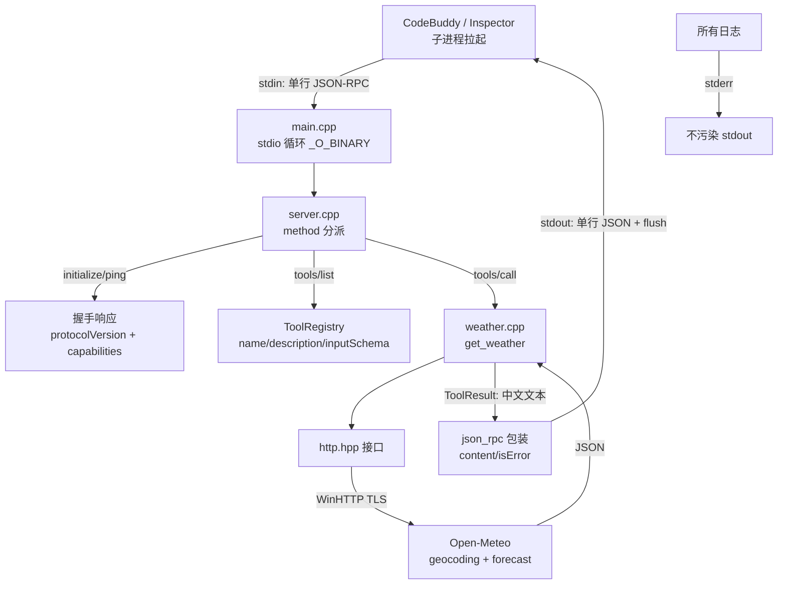

## 产品概述

在空仓库 `d:/Code/MCP` 中，从零手写一个 **C++ MCP Server（stdio 传输 + 天气查询工具）**，目的是让一名 C++ 程序员吃透 MCP 协议本身，而不是交付生产级服务。最终效果：CodeBuddy 侧栏 MCP 面板显示绿色在线状态，在对话中用自然语言问「北京明天天气怎样」，模型调用自建工具并返回中文天气结果。

## 核心功能

1. **MCP 协议握手**：实现 `initialize` / `notifications/initialized` / `ping`，声明 `tools` capability 与 serverInfo，CodeBuddy 能成功建立连接。
2. **工具发现**：实现 `tools/list`，返回天气工具的 name、description、inputSchema（JSON Schema）。
3. **工具调用**：实现 `tools/call`，按 MCP 规定返回 `{content:[{type:"text",text:"..."}],isError:false}`；工具内部错误走 `isError:true` 并把原因文本回给模型，未知 method 走 JSON-RPC `-32601`。
4. **天气查询**：城市中文名 → 地理编码（经纬度）→ Open-Meteo 预报两段式调用；WMO 天气码转中文描述；同名城市返回候选列表让用户/模型消歧；网络失败给出可读的错误文本。
5. **可独立验证**：提供 PowerShell 冒烟脚本，不打开任何 GUI 就能手喂 JSON-RPC 报文、看到响应，再接入 CodeBuddy。

## 边界与约束

- 不引入任何第三方 MCP SDK（官方无 C++ SDK），JSON-RPC 与消息循环全部自己写。
- 只用 stdio，不做 Streamable HTTP、不做鉴权、不做远程部署。
- 一个工具（`get_weather`）走通全流程即可，不预先拆分资源/prompts/多工具框架。

## 技术栈选型

- **语言与标准**：C++17（`std::optional`、`std::string_view` 够用，MSVC / GCC / Clang 均可）
- **构建**：CMake ≥ 3.20 + Ninja 或 Visual Studio 生成器，MSVC（`/utf-8`）为主
- **JSON**：`nlohmann/json` 单头文件版本，直接 vendored 到 `third_party/json.hpp`（**不用 vcpkg / FetchContent**，避免首次构建拉网络 + OpenSSL 编译）
- **HTTP(S)**：Windows **WinHTTP**（`#include <winhttp.h>`，链接 `winhttp.lib`）— 零外部依赖、原生支持 TLS
- **MCP 规范版本**：`2026-07-28`
- **数据源**：Open-Meteo Geocoding API + Forecast API（免 API key）
- **验证**：自写 PowerShell 冒烟脚本；可选官方 MCP Inspector（`npx @modelcontextprotocol/inspector`）

**为什么不用 vcpkg + cpr/cpp-httplib**：HTTPS 在 Windows 上需要 OpenSSL，一趟源码编译（含 OpenSSL、libcurl/cpr）常耗时十几分钟且易踩 CRT/MT-MD 链接坑，与"学习 MCP 协议"的目标争夺精力。WinHTTP 是系统自带、编译即用，代价是这份实现 Windows-only——因此把 HTTP 藏在一个极薄的接口后面（单一职责），将来要跨平台只需新增 `http_curl.cpp`，不改动上层逻辑。升级路线文中给出确切 vcpkg 命令作为可选补充。

## 实现思路

**分层极薄，四层边界清晰**：`WinHTTP 实现 → httpGet 接口 → 工具函数 → MCP 服务器 → stdio 主循环`。协议层和"业务（天气）"层互不感知，工具只依赖一个 `ToolResult` 结构，方便后续照抄加第二个工具。

**stdio 传输的关键事实**：客户端以子进程拉起 server，stdin/stdout 之间交换的是**换行分隔的单行 JSON**（不是 LSP 的 `Content-Length` 分帧）。因此主循环就是：逐行 `getline` → `json::parse` → 分派 → 写回一行 + `flush`。

**Windows 三条硬约束（必须写进代码注释）**：

1. 启动即 `_setmode(_fileno(stdin), _O_BINARY)` 与 `_setmode(_fileno(stdout), _O_BINARY)`，否则 `\n` 被翻译成 `\r\n`，且字节 `0x1A` 会被当 EOF 提前截断流。
2. **stdout 只准输出协议报文**，任何日志/调试一律 `std::cerr` 或写文件；一行 `printf` 污染会导致客户端直接判定连接失败，且这种 bug 极难察觉。
3. 读行后 trim 掉尾部 `\r`；源码统一 UTF-8 保存并给 MSVC 加 `/utf-8`，避免中文字面量变乱码。

**健壮性（控制爆炸半径）**：

- 单行 JSON 解析失败 → 记 stderr 并跳过，**不让进程退出**（客户端可能后续还要用）。
- 未知 method → 返回 JSON-RPC error `-32601`；`id` 缺失（通知）→ 不回响应（这是 `notifications/initialized` 的正确行为）。
- 批量数组形式的请求本阶段不支持，遇到数组就回 `-32600`，留作后续扩展点。
- 协议版本协商：直接回我们实现的版本常量 `2026-07-28`；若客户端要求版本不在支持集合内，仍回自身版本由客户端决定是否继续（学习阶段简单优先，代码里注明）。

**天气链路性能与容错**：

- 请求 Daemon：`disable=<nothing>`; 直接 WinHTTP 同步 GET，**超时 8–10 秒**（`WinHttpSetTimeouts`），避免 MCP 调用无限期挂起。
- 城市 → 坐标做一层**进程内 `unordered_map` 缓存**（同一会话重复问同一城市省一次 RTT）；跨进程缓存本阶段不做（YAGNI）。
- geocoding 返回多条结果时，不擅自取第一条，而是返回候选文本（`北京市/中国-北京`, ...）让模型/用户二次确认，避免"查错城市"这类静默错误。
- HTTP 非 200 或 Open-Meteo 返回 `{"error":true,"reason":...}` → 转成 `isError:true` 的可读文本，而不是崩溃。

**Open-Meteo 接口（已核实）**：

- 地理编码：`https://geocoding-api.open-meteo.com/v1/search?name=<城市>&count=5&language=zh&format=json`，取 `results[].{name,latitude,longitude,country,admin1,timezone}`
- 预报：`https://api.open-meteo.com/v1/forecast?latitude=..&longitude=..&current=temperature_2m,relative_humidity_2m,apparent_temperature,weather_code,wind_speed_10m&daily=weather_code,temperature_2m_max,temperature_2m_min,precipitation_probability_max&timezone=auto&forecast_days=3&temperature_unit=celsius&wind_speed_unit=kmh`
- **硬要求**：只要请求 `daily`，必须带 `timezone` 参数
- WMO code → 中文：0 晴 / 1 大部晴朗 / 2 局部多云 / 3 阴 / 45 雾 / 48 雾凇 / 51,53,55 毛毛雨 / 56,57 冻雨(弱) / 61,63,65 小雨,中雨,大雨 / 66,67 冻雨 / 71,73,75 小雪,中雪,大雪 / 77 米雪 / 80,81,82 阵雨 / 85,86 阵雪 / 95 雷阵雨 / 96,99 雷暴伴冰雹

## 架构设计



**单一职责划分**：`transport` 只管字节进出与二进制模式，`server` 只管 JSON-RPC 语义与分派，`tools/weather` 只管业务与 HTTP，`http` 只是一层可替换的 GET。

## 目录结构

```
d:/Code/MCP/
├── CMakeLists.txt                 # [NEW] C++17；MSVC 加 /utf-8；链接 winhttp.lib；
│                                  #       源文件列表 + third_party include 目录；Release 输出到 build/Release
├── third_party/
│   └── json.hpp                   # [NEW] nlohmann/json 单头文件（下载后 vendored，随仓库走）
├── include/mcp/
│   ├── http.hpp                   # [NEW] HttpResponse{status,body,error} + httpGet(url,timeout) 声明，跨平台接口
│   ├── json_rpc.hpp               # [NEW] makeResponse / makeError(-32601,-32600,-32700) / parseRequest 小工具
│   ├── transport_stdio.hpp        # [NEW] readLine() / writeLine() 声明，封装 _O_BINARY 与 flush
│   └── server.hpp                 # [NEW] ToolResult / ToolDef / ToolHandler / ToolRegistry / handleRequest 声明
├── src/
│   ├── main.cpp                   # [NEW] 设置二进制模式 → 注册工具 → 逐行循环 until EOF；日志走 stderr
│   ├── server.cpp                 # [NEW] initialize/ping/tools/list/tools/call 分派；通知无响应；未知 method -32601
│   ├── transport_stdio.cpp        # [NEW] 跨平台 stdio 读写实现（Windows 分支 _setmode）
│   ├── http_winhttp.cpp           # [NEW] WinHTTP 同步 GET：CrackUrl / Open / SetTimeouts / 读 body / 错误转 error 字段
│   └── tools/
│       └── weather.cpp            # [NEW] get_weather：geocoding → forecast 两段调用；WMO 中文映射；
│                                  #       候选城市消歧；进程内坐标缓存；网络失败转 isError 文本
├── tests/
│   ├── requests.txt               # [NEW] 三~四行样例报文：initialize、notifications/initialized、tools/list、tools/call
│   └── smoke.ps1                  # [NEW] PowerShell 冒烟：Get-Content requests.txt | .\weather-mcp.exe，打印 stderr + 校验响应
├── README.md                      # [NEW] 构建命令、WinHTTP 取舍说明、CodeBuddy MCP 配置片段、Windows 坑与排错清单
└── .gitignore                     # [NEW] 忽略 build/ 等
```

## 关键代码结构

```cpp
// include/mcp/server.hpp —— 工具契约：业务层只需认识这一个结构
struct ToolResult {
    std::string text;   // 返回给模型的文本内容
    bool isError;       // 工具执行失败（区别于 JSON-RPC 协议错误）
};

struct ToolDef {
    std::string name;
    std::string description;
    nlohmann::json inputSchema;                        // JSON Schema object
    std::function<ToolResult(const nlohmann::json&)> handler;
};
```

```cpp
// include/mcp/http.hpp —— 唯一的可替换依赖面（WinHTTP / curl 二选一实现）
struct HttpResponse { long status{}; std::string body; std::string error; };

// timeout 默认 10s；status==0 表示传输层失败，原因写在 error
HttpResponse httpGet(const std::string& url, std::chrono::milliseconds timeout);
```

```
// tools/list 中 weather 工具的 inputSchema（供模型生成参数）
{
  "type": "object",
  "properties": {
    "city": { "type": "string", "description": "城市中文名或英文名，如 北京 / Tokyo" },
    "days": { "type": "integer", "minimum": 1, "maximum": 16, "description": "预报天数，默认 3" }
  },
  "required": ["city"]
}
```

## 实现注意事项

- **日志 discipline**：只在 stderr 打印 `[mcp]` 前缀的少量日志（收到的 method、HTTP 状态码），不打印完整请求体，避免刷屏。
- **`tools/call` 语义区分**：参数缺 `city` → 返回 `content` + `isError:true`（模型能自我纠正）；method 拼错 → JSON-RPC `-32601`；报文坏 JSON → `-32700` 并继续读下一行。
- **每行必须 `std::cout << line << '\n' << std::flush`**，缺 flush 会让客户端一直等待。
- **CodeBuddy 接入**（已核实官方格式）：侧栏 CodeBuddy Settings → MCP → Add MCP，写入

```
{ "mcpServers": { "weather": { "type": "stdio",
"command": "D:/Code/MCP/build/Release/weather-mcp.exe",
"args": [], "description": "城市天气查询（Open-Meteo）" } } }
```

Windows 路径用正斜杠，改配置后需重启 server 进程；先在 Terminal 用 `smoke.ps1` 确认协议通，再排 UI 的错。

- **升级为跨平台（可选）**：`vcpkg install nlohmann-json cpr`（triplet 建议 `x64-windows-static`）后新增 `src/http_curl.cpp`，CMake 用 `if(WIN32)` 选择实现，其余代码零改动。